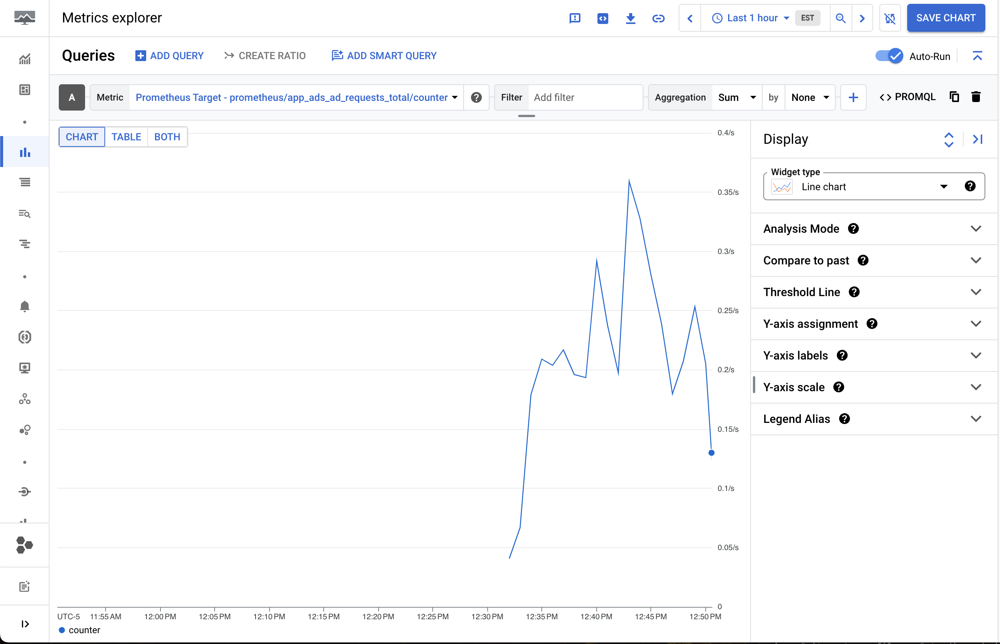
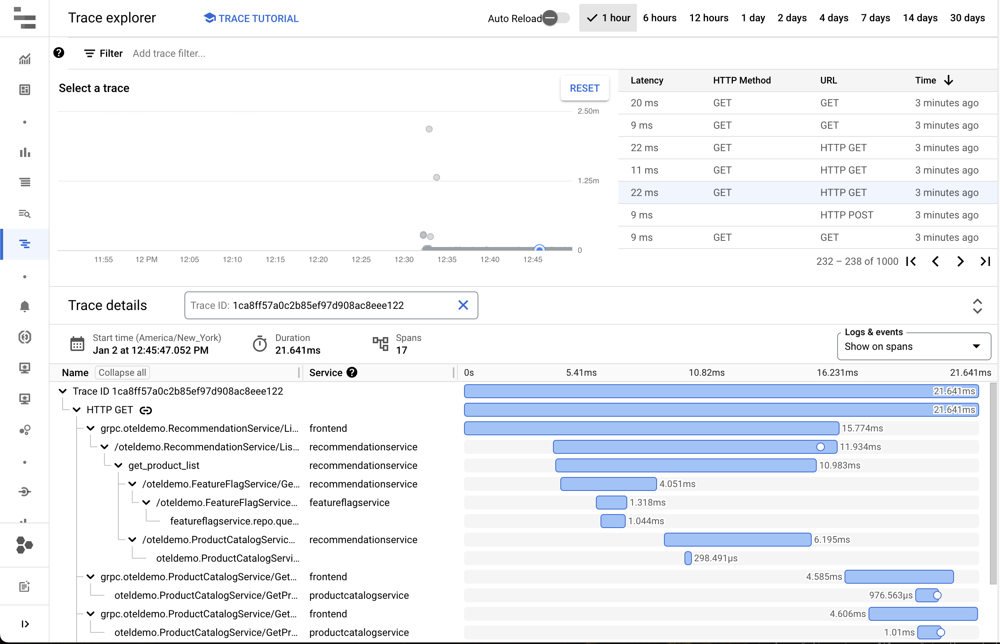
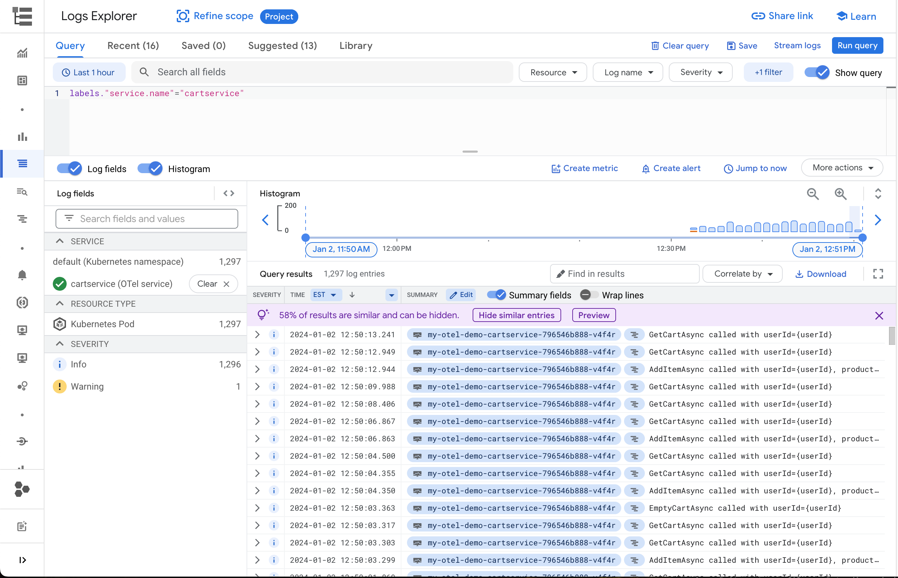

# OpenTelemetry Demo with Google Cloud

This repository contains deployment configuration and instructions for deploying
the upstream [OpenTelemetry Demo](https://github.com/open-telemetry/opentelemetry-demo)
configured to work with Google Cloud Observability products (Cloud Monitoring,
Cloud Logging, and Cloud Trace).

**This is not an officially supported Google product.**

## Repository Overview

This repository does not contain the source code for the microservices. It is
used to deploy the OpenTelemetry Astronomy Shop (using upstream images) and
configure GCP integrations.

- For general information about the upstream demo, see the
  [upstream repository](https://github.com/open-telemetry/opentelemetry-demo).
- For guidelines on how to contribute or develop in this repo, see
  [CONTRIBUTING.md](CONTRIBUTING.md) and [agents.md](agents.md).
- To register the deployed demo with GCP App Hub, see the
  [App Hub Skill](.agents/skills/register-apphub/SKILL.md).

## Running on GKE

The recommended way to run the demo on GKE is with the official Helm chart via Helmfile.

### GKE Managed OpenTelemetry Prerequisites

You must enable Managed OpenTelemetry on your GKE cluster.

For a new GKE Autopilot cluster:

```console
gcloud beta container clusters create-auto CLUSTER_NAME \
    --project=PROJECT_ID \
    --managed-otel-scope=COLLECTION_AND_INSTRUMENTATION_COMPONENTS \
    --location=LOCATION
```

For a new GKE Standard cluster:

```console
gcloud beta container clusters create CLUSTER_NAME \
    --project=PROJECT_ID \
    --managed-otel-scope=COLLECTION_AND_INSTRUMENTATION_COMPONENTS \
    --location=LOCATION
```

Or update an existing cluster:

```console
gcloud beta container clusters update CLUSTER_NAME \
    --project=PROJECT_ID \
    --managed-otel-scope=COLLECTION_AND_INSTRUMENTATION_COMPONENTS \
    --location=LOCATION
```

Replace `CLUSTER_NAME`, `PROJECT_ID`, and `LOCATION` with your cluster's details.

Note: The cluster version must be `1.34.1-gke.2178000` or later.

### Deploying with Helmfile

Make sure you have the following installed:

- [Helmfile](https://helmfile.readthedocs.io/en/stable/#installation)
- [Helm](https://helm.sh/docs/intro/install/)
- [helm-diff plugin](https://github.com/databus23/helm-diff)

Ensure you have either configured or disabled Workload Identity in your cluster.

```console
helmfile --interactive apply -f gcp/helmfile.yaml
```

#### Cleaning up

To clean up, run:

```console
helmfile --interactive destroy -f gcp/helmfile.yaml
```

### (Alternative) Using `kubectl apply`

Installing with the Helm chart is recommended, but you can also use
`kubectl apply` to install the manifests directly.

First, make sure you have followed the Workload Identity setup steps above.

Install the manifests:

```console
kubectl apply --server-side -n otel-demo -f ./kubernetes/opentelemetry-demo.yaml
```

## Seeing Telemetry

With the demo running, you should see telemetry automatically created by the
demo's load generator. You can see metrics under "Prometheus Target" in Cloud
Monitoring:



Traces in the Trace explorer:



And logs in the Logs explorer organized by service:


